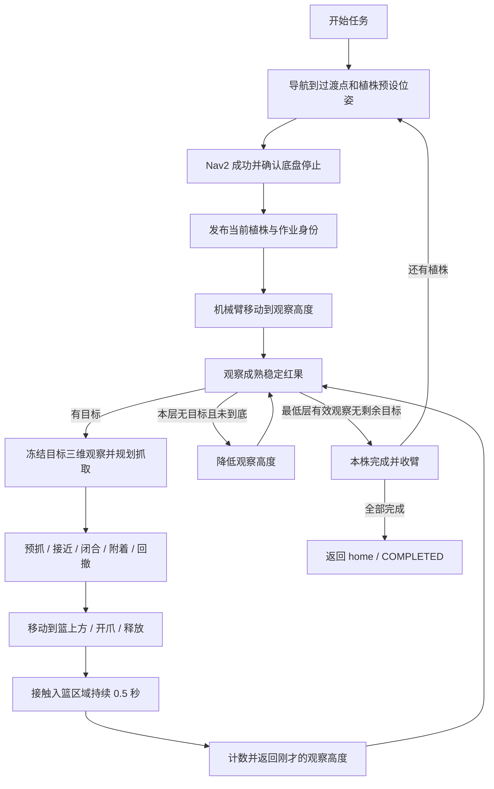

# Agricultural_Bot 农业番茄采摘机器人项目说明

本文依据 2026-10-16 的项目代码和当前演示资产编写，介绍机器人用途、工程结构、算法、数据接口及主系统启动方法。目录只列与主功能有关的文件，不展开外部项目来源、历史备份和独立附加仿真程序。

首次在新机器复现时，先完成第 14 章的环境、依赖、资产和构建配置，再按第 10 章启动自动采摘。第 14 章的本机版本记录核对日期为 **2026-10-17**。

## 1. 机器人用途与当前实现范围

机器人面向温室番茄采摘演示：四轮独立转向底盘沿种植通道移动，到达预设植株作业点后停稳；六轴机械臂携带 RGB-D 相机观察植株，识别成熟红果，计算三维观察位置，使用两指夹爪摘取并放入车载收集篮，然后继续本株观察和采摘。

当前主功能包括：

- 参数化生成番茄田、植株和独立果实模型。
- 激光建图、保存地图定位、单通道预设航点导航。
- RGB-D 成熟红果检测、实例分割、深度估计与机器人坐标转换。
- 到站任务交接、机械臂分层扫描、抓取规划与关节轨迹执行。
- 仿真果实附着、释放、入篮确认及单株多果采摘。
- 单株作业结束后前往下一站，完成任务后返回入口停靠点。

当前场地包含 **6 行、每行 10 株**，自动任务使用中央一条通道两侧的 **20 个植株航点**。它不是在六行之间任意切换的全场巡检任务。采用单通道范围也有助于减轻重复植株造成的定位混淆。

代码已经支持完整 20 航点任务；具体植株的视觉、接近与夹持效果仍在逐站联调。仿真成功记录不等于实体机器人已经完成抓取标定和验证。

## 2. 技术栈

| 层次 | 技术 | 在本项目中的作用 |
| --- | --- | --- |
| 运行环境 | Ubuntu 24.04、ROS 2 Jazzy、Python 3.12 | 节点运行、消息通信和任务逻辑 |
| 编译组织 | colcon、ament_python、ament_cmake、CMake、C++17 | Python 功能包和 C++ 仿真系统构建 |
| 三维仿真 | Gazebo Harmonic、SDF | 世界、刚体、碰撞、关节和传感器仿真 |
| 机器人描述 | URDF、Xacro、STL、DAE | 整机结构、坐标、视觉和碰撞模型 |
| 通信与坐标 | ROS Topic / Service / Action、TF2、ros_gz_bridge、ros_gz_image | 模块通信、Gazebo 数据桥接和坐标变换 |
| 关节执行 | ros2_control、gz_ros2_control、JointTrajectoryController | 底盘、机械臂和夹爪的控制接口 |
| 建图与定位 | SLAM Toolbox、AMCL | 二维激光建图、地图定位和 `map → odom` 修正 |
| 导航 | Nav2、NavFn、DWB、行为树 | 全局路径、局部速度选择和导航任务编排 |
| 感知 | YOLO 实例分割、Ultralytics 8.4.174、PyTorch、CUDA、OpenCV、NumPy | 红绿果识别、分割和 RGB-D 三维观测 |
| 机械臂规划 | MoveIt 2、KDL、OMPL | 逆运动学、关节路径、笛卡尔路径和轨迹参数化 |
| 可视与调试 | RViz2、rqt、ros2 CLI、pytest、CTest | 地图、TF、点云、图像、状态及回归检查 |

算法框架名称用于解释技术实现；本说明不列来源仓库或二次开发关系。

## 3. 工程组织与关键文件

### 3.1 工作空间关系

```text
/opt/ros/jazzy
      ↓
ros2_ws       机器人模型、感知、导航、任务和机械臂算法
      ↓
sim_ws        仿真模型扩展、世界、传感器、执行和仿真验收
```

环境按这个顺序加载。`ros2_ws` 是机器人主功能层，`sim_ws` 在它之上连接 Gazebo。实际运行使用两个工作空间各自的 `install/`，无需在项目顶层混合构建全部包。

下面树中的 `#` 注释说明对应文件的职责。`package.xml` 定义依赖，`setup.py` 或 `CMakeLists.txt` 定义安装与可执行入口；这些同类文件不逐包重复列出。各包 `test/` 保存单元或集成回归。

```text
Agricultural_Bot/
├── scripts/
│   ├── harvest_demo_env.bash              # 统一环境、ROS 域、Gazebo 分区和当前演示资产路径
│   ├── prepare_collision_navigation.py    # 准备硬障碍导航地图及配套场景资产
│   ├── prepare_close_harvest.py            # 生成靠近作业侧的停靠任务及绑定信息
│   ├── prepare_small_fruit_candidate.py    # 准备 50–60 mm 果实场景及任务资产
│   └── check_harvest_preflight.py          # 前置接口回归工具，使用隔离的测试输入
├── data/weights/best.pt                   # 当前番茄检测、实例分割权重
├── ros2_ws/src/
│   ├── agri_robot_description/
│   │   ├── urdf/agri_robot.urdf.xacro      # 整机统一模型入口
│   │   ├── urdf/xacro/parameters.xacro    # 整机几何、安装与关节参数
│   │   ├── urdf/xacro/base.xacro          # 底盘主体和根坐标关系
│   │   ├── urdf/xacro/wheel_modules.xacro # 四组转向、驱动轮关节
│   │   ├── urdf/xacro/cr5.xacro           # 六轴机械臂刚体与关节链
│   │   ├── urdf/xacro/gripper.xacro       # 双指夹爪和 grasp_tcp
│   │   ├── urdf/xacro/basket.xacro        # 车载收集篮
│   │   ├── urdf/xacro/sensors.xacro       # 雷达、相机安装及光学坐标
│   │   ├── urdf/xacro/materials.xacro     # 整机显示材质
│   │   ├── urdf/xacro/gazebo_overlay.xacro # 仿真所需模型属性
│   │   ├── meshes/                       # 上述模型引用的视觉及碰撞网格
│   │   └── launch/display.launch.py      # 独立查看整机模型
│   ├── agri_base_kinematics/
│   │   ├── agri_base_kinematics/kinematics.py # 四轮转向逆解、反馈正解和里程计积分
│   │   ├── agri_base_kinematics/four_wheel_steering_node.py # 速度/关节反馈与轮控制连接
│   │   ├── config/four_wheel_steering.yaml # 轮位置、半径、关节方向和接口参数
│   │   └── launch/four_wheel_steering.launch.py # 底盘运动学节点入口
│   ├── agri_base_adapter/
│   │   ├── agri_base_adapter/velocity_gate_node.py # 手动/导航速度选择、停车作业接口
│   │   ├── agri_base_adapter/velocity_gate.py # 速度接口的独立逻辑
│   │   ├── agri_base_adapter/odom_adapter_node.py # /wheel/odom 转标准 /odom
│   │   ├── agri_base_adapter/harvest_interlock.py # 作业状态与底盘状态契约
│   │   ├── config/base_adapter_close_harvest_omni.yaml # 当前演示底盘接口配置
│   │   └── launch/base_adapter.launch.py  # 启动底盘适配节点
│   ├── agri_lidar_adapter/
│   │   ├── agri_lidar_adapter/cloud_filter.py # 时间对应 TF、范围/高度/自身过滤
│   │   ├── config/lidar_to_scan.yaml      # 点云过滤和二维扫描参数
│   │   ├── launch/lidar_to_scan.launch.py # 主雷达点云转 /scan
│   │   └── launch/collision_scan.launch.py # 硬障碍点云转 /scan_obstacles
│   ├── agri_navigation/
│   │   ├── launch/mapping.launch.py      # 同步二维激光建图入口
│   │   ├── launch/localization.launch.py # 单独启动保存地图定位
│   │   ├── launch/navigation.launch.py   # 地图、定位、规划、控制及导航生命周期
│   │   ├── config/slam_toolbox_single_corridor.yaml # 当前单通道建图配置
│   │   ├── config/amcl.yaml              # 基础定位配置
│   │   ├── config/nav2_close_harvest_omni_v8.yaml # 当前采摘导航配置
│   │   ├── agri_navigation/navigation_parameters.py # 分离定位/障碍输入并组装参数
│   │   ├── agri_navigation/navigation_smoothing.py # 速度平滑配置与话题连接
│   │   ├── maps/tomato_field_default.yaml # 定位地图入口，关联同名 PGM
│   │   └── maps/tomato_field_default_keepout.yaml # 禁行区地图入口，关联同名 PGM
│   ├── agri_perception/
│   │   ├── agri_perception/tomato_detector.py # 图像接收、YOLO、分割、TF 与结果发布
│   │   ├── agri_perception/target_quality.py # 深度随机采样、中值/MAD、同步与目标跟踪
│   │   └── launch/tomato_detector.launch.py # 模型、设备和观测质量参数入口
│   ├── agri_harvest_interfaces/
│   │   ├── msg/TomatoTarget.msg           # 单目标身份、类别、三维点和质量证据
│   │   ├── msg/TomatoTargetArray.msg      # 同次 RGB-D 观察的目标数组
│   │   ├── msg/HarvestWorkerState.msg     # 机械臂作业身份、阶段和收纳状态
│   │   ├── action/HarvestWork.action      # 单植株扫描/采摘任务、反馈与结果
│   │   └── srv/SimFruitCommand.srv        # 仿真果实选择、接触、附着、释放和状态查询
│   ├── agri_task_manager/
│   │   ├── agri_task_manager/waypoint_schema.py # 航点、场景和地图的格式及绑定校验
│   │   ├── agri_task_manager/generate_single_corridor_mission.py # 生成两侧逐株任务
│   │   ├── agri_task_manager/route_validation.py # 地图栅格、禁行区和底盘足迹验证
│   │   ├── agri_task_manager/validate_field_route.py # 离线任务校验 CLI
│   │   ├── agri_task_manager/field_route_executor.py # 导航、到站交接、任务推进和返航
│   │   ├── agri_task_manager/harvest_coordinator.py # 到站上下文转为采摘 Action
│   │   ├── agri_task_manager/harvest_safety.py # 停稳、目标质量和事务身份检查
│   │   ├── launch/field_route.launch.py   # 只运行航点执行器
│   │   └── launch/harvest_preflight.launch.py # 航点执行器与采摘协调器组合
│   ├── agri_arm_moveit_config/
│   │   ├── launch/moveit.launch.py        # 连接已运行的 Gazebo 关节状态启动规划
│   │   ├── config/agri_arm.srdf           # 规划组、末端及连杆碰撞关系
│   │   ├── config/kinematics.yaml         # KDL 逆运动学配置
│   │   ├── config/ompl_planning.yaml      # 默认 RRTConnect 等关节路径规划器
│   │   ├── config/joint_limits.yaml       # 机械臂规划参数
│   │   └── config/moveit_controllers.yaml # 规划组到轨迹控制器的对应关系
│   └── agri_arm_control/
│       ├── agri_arm_control/harvest_worker.py # 单植株 Action 服务和多果采摘循环
│       ├── agri_arm_control/observation_scan.py # 朝作业侧观察并沿 Z 逐层下降
│       ├── agri_arm_control/geometry.py   # 抓取候选、坐标变换及篮上投放位姿
│       ├── agri_arm_control/controller.py # IK/FK、规划、轨迹提交与实测反馈
│       ├── agri_arm_control/grasp_executor.py # 单果接近、夹持、回撤、投篮步骤
│       ├── agri_arm_control/contact_closure.py # 按双指接触状态逐步闭合
│       ├── agri_arm_control/safety.py     # 关节反馈和控制器状态检查
│       ├── agri_arm_control/hardware.py   # 执行后端与硬件接口识别
│       ├── agri_arm_control/deadline.py   # 仿真时间与墙钟的轨迹执行预算
│       ├── config/harvest_arm_worker.yaml # 基础观察、夹持和投篮参数
│       └── launch/harvest_arm_worker.launch.py # 启动机械臂作业节点
├── sim_ws/src/
│   ├── agri_sim_description/
│   │   ├── urdf/agri_robot.gazebo.urdf.xacro # 统一模型的 Gazebo 扩展入口
│   │   └── launch/simulation.launch.py   # 世界、机器人放置、桥接、控制和传感器
│   ├── agri_sim_control/
│   │   ├── config/controllers.yaml      # 轮、机械臂、夹爪控制器配置
│   │   └── launch/control.launch.py     # 加载并激活控制器
│   ├── agri_sim_sensors/
│   │   ├── urdf/mid360.gazebo.xacro      # 三维雷达仿真
│   │   ├── urdf/d405.gazebo.xacro        # RGB-D 相机仿真
│   │   ├── urdf/collision_scan.gazebo.xacro # 硬障碍专用观测
│   │   ├── config/mid360.yaml           # 主雷达配置
│   │   ├── config/d405_extended_sim.yaml # 当前 2 m 深度范围相机配置
│   │   ├── config/collision_scan.yaml   # 硬障碍扫描配置
│   │   ├── agri_sim_sensors/normalize_cloud.py # 统一雷达消息数据约定
│   │   └── agri_sim_sensors/normalize_camera_info.py # 内参像素中心校正；保留光学帧
│   ├── agri_greenhouse_worlds/
│   │   ├── scripts/generate_tomato_field.py # 参数化生成世界 SDF 和元数据 JSON
│   │   ├── scripts/generate_keepout_mask.py # 生成通道禁行区域
│   │   └── worlds/tomato_field_default.sdf # 包内基础默认场景
│   ├── agri_harvest_sim/
│   │   ├── scripts/make_harvestable_world.py # 将独立果实转换为可采摘动态刚体
│   │   ├── scripts/harvest_scene.py      # ROS 果实服务与 MoveIt 场景同步
│   │   ├── scripts/scene_geometry.py     # 植株、果实及坐标几何计算
│   │   ├── scripts/gazebo_transport.py   # Gazebo 请求与响应封装
│   │   ├── src/HarvestSystem.cc         # 果实附着、释放、入篮生命周期
│   │   ├── src/GripEvidence.hh          # 双指实际接触证据判定
│   │   ├── src/BasketEvidence.hh        # 果实接触入篮区域及连续时间判定
│   │   └── launch/harvest_scene.launch.py # 场景服务入口
│   ├── agri_sim_bringup/
│   │   ├── launch/tomato_field.launch.py # 番茄田仿真主入口
│   │   └── launch/harvest_arm.launch.py  # 规划、场景、机械臂及任务的联合入口
│   └── agri_sim_tests/
│       └── agri_sim_tests/check_*.py     # 雷达、相机、二维扫描和建图验收
└── artifacts/close_harvest_20261014/
    ├── harvest_arm_worker_lower_scan_090.yaml # 当前实际使用的扫描/抓取配置
    └── small_fruit_50_60_candidate/
        ├── tomato_field_harvestable.sdf  # 当前采摘演示实际运行的世界
        ├── tomato_field.json            # 与该世界匹配的植株和果实记录
        ├── harvest_mission_full20.yaml   # 完整 20 植株任务
        ├── harvest_mission_first_station_manual.yaml # 第一个植株单站任务
        └── navigation/navigation_collision.yaml # 导航障碍地图，关联同目录 PGM
```

### 3.2 当前演示资产的选择

`scripts/harvest_demo_env.bash` 指定当前实际使用的场景、任务和参数。包内 `worlds/tomato_field_default.sdf` 是基础场景；启动当前采摘演示需要明确传入 `tomato_field_harvestable.sdf`。

当前演示场地参数为：6×10 株、行距 3 m、株距 0.7 m、地面 22×14 m、株高 2.4 m、株宽 1 m、茎代理宽 0.06 m、果实直径 50–60 mm。元数据当前记录 224 个果实，其中 165 个成熟红果；这是整个场景统计，并非 20 个作业植株的预期采摘计数。

当前 SDF 含后续逐果位置调整，单独使用原随机种子重新生成不能保证复现这些调整。跨机器复制演示时应同时携带实际使用的 SDF、JSON、两份任务 YAML、导航地图及权重文件；`artifacts/` 在这里包含运行输入，不能全部视作可删除日志。

任务文件绑定场景 SDF、元数据、地图和禁行区的校验值。改变场景后，配套元数据及任务绑定也要同步。行距、行数、主干障碍或地图注册关系改变时，还需重新准备地图和航点。

## 4. 各功能包与算法

| 功能包 | 实现内容 | 算法或实现方法 |
| --- | --- | --- |
| `agri_robot_description` | 统一底盘、机械臂、夹爪、篮和传感器模型 | 刚体关节链，URDF/Xacro；关节反馈驱动机器人 TF |
| `agri_base_kinematics` | 车体速度到四轮命令，轮反馈到里程计 | 平面刚体速度分解、转向等价解选择、最小二乘速度估计、中点积分 |
| `agri_base_adapter` | 统一手动/导航速度、停车接口和标准里程计 | 速度源选择、带时间戳接口、作业状态交接、里程计帧适配 |
| `agri_lidar_adapter` | 点云处理和二维扫描 | TF 变换、有效点/范围/高度/自身过滤、可选体素采样、角度分箱取最近点 |
| `agri_navigation` | 建图、定位和导航 | 二维扫描匹配、位姿图优化；AMCL 粒子滤波；Dijkstra；DWB 轨迹评分；行为树 |
| `agri_perception` | 红绿果识别和成熟果三维观测 | YOLO 实例分割、随机深度采样、中值/MAD、针孔反投影、短期目标关联 |
| `agri_harvest_interfaces` | 模块间数据契约 | 自定义消息、Service 和 Action |
| `agri_task_manager` | 植株航点、作业交接和返航 | 状态机、事务 ID 匹配、栅格足迹检查、场景/地图 SHA-256 绑定 |
| `agri_arm_moveit_config` | 六轴臂规划配置 | KDL 逆运动学，默认 OMPL RRTConnect，时间最优轨迹参数化 |
| `agri_arm_control` | 扫描、选果、抓取、连续采摘与收臂 | 分层观察、多姿态 IK、关节空间预抓、笛卡尔接近/回撤、双指接触闭合 |
| `agri_sim_description` | 统一模型接入仿真 | Xacro 展开、Gazebo 机器人放置、数据桥接 |
| `agri_sim_control` | 仿真关节执行 | 转向位置控制、驱动轮速度控制、臂/爪 JointTrajectoryController |
| `agri_sim_sensors` | 激光、RGB-D、硬障碍观测 | GPU 雷达及 RGB-D 渲染、消息和相机内参标准化 |
| `agri_greenhouse_worlds` | 参数化场地和植株 | 规则行列布局、带种子的随机果实分布、SDF/JSON 生成 |
| `agri_harvest_sim` | 果实摘取和入篮的仿真状态 | 独立刚体、可分离固定连接、实际夹持接触与区域接触计时 |
| `agri_sim_bringup` | 主系统启动组合 | launch 参数传递、资产验证和节点组合 |
| `agri_sim_tests` | 传感器与建图验收 | 数据类型、频率、时间戳、坐标、量程及栅格质量检查 |

### 4.1 底盘运动学

对第 `i` 个轮子，其相对车体位置为 `(x_i, y_i)`，目标车体速度为 `(v_x, v_y, ω)`：

```text
v_ix = v_x - ω y_i
v_iy = v_y + ω x_i
轮方向 = atan2(v_iy, v_ix)
轮角速度 = sqrt(v_ix² + v_iy²) / 轮半径
```

程序结合当前轮方向选择转向与轮速正反的等价解。反馈方向和驱动速度用于最小二乘估计车体速度，再积分得到 `/wheel/odom`。它来自轮关节反馈，不能当作 Gazebo 世界真值。

### 4.2 建图、定位与规划

单通道建图配置使用同步激光扫描匹配和位姿图优化，求解器为 Ceres。分辨率 0.05 m；保留局部扫描匹配，关闭非局部回环搜索，降低重复植株引起的跨通道误关联。

保存地图导航使用 AMCL 粒子滤波，当前运动模型为全向模型，激光似然场用于扫描评分。当前配置将定位激光最大有效距离收至 1.8 m，以减少相邻重复行参与评分。

全局规划器为 `NavfnPlanner`，`use_astar: false`，即 **Dijkstra**。局部控制器为 **DWB + StandardTrajectoryGenerator**，对采样的平面速度和角速度进行短时轨迹预测，按路径距离、目标距离、振荡、旋转和末端朝向评分。

当前 v8 设置平面线速度上限为 **1 m/s**，允许倒车和横向移动。其障碍膨胀层关闭，局部评分列表不含足迹碰撞评分项；因此应按当前预设单通道演示使用，不能把它描述成已经验证任意障碍下的完整避障策略。

## 5. 坐标系定义

| 坐标系 | 定义与用途 |
| --- | --- |
| Gazebo `world` | 仿真世界坐标。当前出生位置平面坐标为 `(0, -6)`，出生 yaw 约 `π/2`，朝世界 `+Y` |
| `map` | 建图与导航坐标；当前保存地图按固定出生位置建立注册关系 |
| `odom` | 轮里程计连续坐标；短期连续，定位通过 `map → odom` 修正全局偏差 |
| `base_footprint` | 机器人任务坐标：X 前、Y 左、Z 上；视觉目标和作业侧判断使用它 |
| `base_link` | 继承 CAD 的模型坐标，包含与标准底盘坐标不同的轴向；MoveIt planning frame 使用它 |
| `mid360_sensor_frame` | 雷达实际安装的光学坐标，包含安装倾斜 |
| `mid360_scan_frame` | 雷达同原点的水平扫描坐标，二维 LaserScan 在该帧中表达 |
| `camera_optical_frame` | 相机光学坐标：X 右、Y 下、Z 向镜头前方 |
| `grasp_tcp` | 夹取规划工具点；候选姿态以 TCP 的 +Z 作为接近方向 |

当前任务资产的平面注册关系为：

```text
map_x = world_y + 6
map_y = -world_x
map_yaw = world_yaw - π/2
```

因此 `map` 原点对应世界出生点 `(0,-6)`；地图 `+X` 朝世界 `+Y`，地图 `+Y` 朝世界 `-X`，机器人在地图 yaw=0 时朝地图 `+X`。

地图 YAML 的 `origin: [-0.401, -2.058, 0]` 是栅格图像左下角的位置，不是机器人出生位置。果实 JSON/SDF 高度使用世界 Z；扫描配置的高度使用 `base_footprint` Z，二者需要通过实际 TF 换算。

运行中的主要 TF 链为：

```text
map --AMCL 或建图节点--> odom --轮里程计--> base_footprint
                                             └── base_link
                                                 ├── 雷达安装与扫描坐标
                                                 └── 机械臂关节链
                                                     ├── grasp_tcp
                                                     └── camera_optical_frame
```

建图与 AMCL 不应同时发布同一条 `map → odom`。相机数据转换按图像采集时刻查询 TF，不能只替换 `frame_id` 标签。

## 6. 仿真传感器话题与信息流

本节频率是配置目标值，实际墙钟频率受仿真实时率、渲染和推理耗时影响。

### 6.1 Gazebo 到 ROS 的传感器输出

| Gazebo 话题 | ROS 话题 | 消息类型 | 配置/坐标 |
| --- | --- | --- | --- |
| `/world/field/clock` | `/clock` | `rosgraph_msgs/msg/Clock` | 仿真时钟，所有仿真节点使用 `use_sim_time=true` |
| `/mid360/points` | `/mid360/points` | `sensor_msgs/msg/PointCloud2` | 10 Hz，0.1–40 m，`mid360_sensor_frame` |
| `/hard_obstacles/points` | `/hard_obstacles/points` | `sensor_msgs/msg/PointCloud2` | 10 Hz，0.1–8 m，仿真硬障碍专用观测 |
| `/d405/image` | `/d405/color/image_raw` | `sensor_msgs/msg/Image` | 848×480，30 Hz，通常 `rgb8` |
| `/d405/depth_image` | `/d405/aligned_depth_to_color/image_raw` | `sensor_msgs/msg/Image` | 848×480，30 Hz，`32FC1`，米 |
| `/d405/camera_info` | `/d405/color/camera_info/gz_raw` → `/d405/color/camera_info` | `sensor_msgs/msg/CameraInfo` | 光学帧、K/P 内参、像素中心校正 |

RGB 和深度由 `ros_gz_image` 桥接；点云、时钟和原始相机内参由 `ros_gz_bridge` 桥接。相机内参再由 `normalize_camera_info.py` 统一像素主点约定。

当前相机使用 `d405_extended_sim.yaml`，深度范围 **0.07–2.0 m**，水平/垂直视场约 87°/58°。这是本项目的扩展仿真范围，不代表实体相机已验证相同性能。

### 6.2 两条激光链

```mermaid
flowchart LR
  A[主雷达可见场景点云] --> B[/mid360/points]
  B --> C[水平 TF 变换和过滤]
  C --> D[/mid360/navigation_points]
  D --> E[角度分箱取最近距离]
  E --> F[/scan]
  F --> G[建图或 AMCL 定位]
  H[仿真硬障碍观测] --> I[/hard_obstacles/points]
  I --> J[水平 TF 变换和过滤]
  J --> K[/hard_obstacles/navigation_points]
  K --> L[/scan_obstacles]
  L --> M[导航障碍代价地图]
```

主雷达保留可见枝叶特征供定位；硬障碍观测忽略柔软枝叶显示几何，观察硬茎代理等对象。它是仿真观测方式，不是额外一台实体雷达。

两种扫描均为 `sensor_msgs/msg/LaserScan`，使用 `mid360_scan_frame`，角分辨率 1°、全周扫描、`scan_time=0.10 s`。点云处理默认截取水平扫描帧中 Z 为 `[-0.40, 0.40] m` 的点，并过滤车体自身区域；体素降采样默认关闭。

### 6.3 RGB-D 到成熟果三维目标

```mermaid
flowchart LR
  A[RGB 图像] --> D[时间配对与 YOLO 实例分割]
  B[对齐深度] --> D
  C[相机内参] --> D
  D --> E[成熟红果筛选]
  E --> F[掩膜内随机采样和中值深度]
  F --> G[针孔反投影与质量检查]
  G --> H[短时目标 ID 和多帧稳定性]
  H --> I[采集时刻 TF 转换]
  I --> J[/agri_vision/tomato_targets_base]
  J --> K[当前植株扫描与目标选择]
```

具体处理：

1. 配对 RGB 与深度，时间差不超过 0.05 s，观察年龄不超过 0.5 s。
2. 使用 `best.pt` 推理，类别名称由模型读取；当前类别为 `tomato_R`、`tomato_G`。
3. 二维显示保留两类，默认三维业务输出只保留成熟红果 `tomato_R`。
4. 分割掩膜向内侵蚀 1 px；在检测框中心邻域随机、无放回采样至多 81 个深度像素。
5. 采样半径取 `min(8 px, 框宽×0.25, 框高×0.25)`，剔除非有限和量程外深度。
6. 要求有效样本至少 15 个、有效率至少 60%、MAD 不超过 0.03 m，取深度中值。
7. 按 `X=(u-cx)Z/fx`、`Y=(v-cy)Z/fy` 反投影。三维点表达检测框中心射线的可见表面位置代理。
8. 依据类别、二维框 IoU 与三维距离做短期关联；0.5 s 窗口内至少 3 帧、跨度至少 0.1 s、位置变化不超过 0.025 m 才标记稳定。
9. 按 RGB 采集时刻转换到 `base_footprint`，发布带 ID、类别、置信度和质量证据的目标。

检测输出频率取决于实际推理和同步速度，不保证等于相机的 30 Hz。没有成熟果的有效图像可以产生有效空数组；图像失联、TF 缺失或时间异常产生无效观察，两者在采摘逻辑中有区别。

### 6.4 感知输出格式

| 话题 | 类型 | 用途 |
| --- | --- | --- |
| `/agri_vision/annotated_image` | `sensor_msgs/msg/Image` | 检测框、类别、置信度与掩膜叠加图 |
| `/agri_vision/detections` | `vision_msgs/msg/Detection2DArray` | 同帧全部二维检测 |
| `/agri_vision/tomato_targets_camera` | `agri_harvest_interfaces/msg/TomatoTargetArray` | 相机坐标下的带身份三维目标 |
| `/agri_vision/tomato_targets_base` | 同上 | 自动采摘消费的机器人坐标目标 |
| `/agri_vision/tomato_positions_camera` | `geometry_msgs/msg/PoseArray` | 兼容工具使用的纯位置输出 |
| `/agri_vision/tomato_positions_base` | 同上 | 兼容机器人坐标位置输出 |

新业务使用 `TomatoTargetArray`。旧 PoseArray 不带类别和目标 ID，其单位四元数也不是有效抓取方向。

```text
TomatoTargetArray
├── header                    # RGB 采集时间、三维点坐标系
├── depth_stamp               # 配对深度的时间
├── observation_valid         # 本次观察是否有效
├── rejection_reason          # 无效原因
└── targets[]
    ├── target_id             # 检测会话内的短期目标 ID
    ├── class_name            # tomato_R / tomato_G
    ├── confidence
    ├── detection_index       # 同帧完整二维检测数组中的索引
    ├── position{x,y,z}       # 米；表面深度代理
    ├── mature
    ├── depth_sample_count
    ├── depth_valid_fraction
    ├── depth_mad_m
    ├── segmentation_used
    ├── temporally_stable
    └── stable_frame_count
```

视觉 `target_id` 与 Gazebo 的 `tomato_21_fruit_0` 不是同一个 ID。仿真服务在接触查询阶段做关联，任务层不应把检测数组下标当作果实身份。

## 7. 导航、控制与任务信息流

### 7.1 地图与底盘链路

当前运行同时使用三类栅格输入：

| 输入 | ROS 话题 | 消费方与作用 |
| --- | --- | --- |
| `tomato_field_default.yaml` | `/map` | AMCL 定位与地图显示 |
| `navigation/navigation_collision.yaml` | `/navigation_map` | 导航静态障碍层与任务地图绑定 |
| `tomato_field_default_keepout.yaml` | `/keepout_filter_mask` | 通道禁行区过滤 |

`navigation.launch.py` 会把实际障碍扫描设置为 `/scan_obstacles`，AMCL 仍使用 `/scan`。因此定位图像中的叶片特征与机器人通行障碍不用完全相同。

```text
任务执行器 → /navigate_to_pose → Nav2 路径规划和局部控制
  → /cmd_vel_nav_raw → /cmd_vel_nav_smoothed → /cmd_vel_nav
  → 底盘速度接口 → /cmd_vel_safe → 四轮转向运动学
  → /steering_controller/commands + /wheel_controller/commands
  → Gazebo 关节执行 → /joint_states
  → 轮反馈里程计 /wheel/odom → /odom
```

速度链使用 `geometry_msgs/msg/TwistStamped`；轮控制话题使用 `std_msgs/msg/Float64MultiArray`；两级里程计使用 `nav_msgs/msg/Odometry`。速度平滑开启时经过 `/cmd_vel_nav_smoothed`，关闭时从原始导航命令直接连接下游。

### 7.2 预设航点

完整任务按照以下顺序执行：

```text
entry_home
  → tomato_20 … tomato_29（左侧依次作业）
  → tomato_39 … tomato_30（右侧反向依次作业）
  → home
```

其中还包含少量通道中心过渡点，用于连接部分近植株停靠位置。每个植株航点携带：

```text
id / sequence / stop_id
base_pose{x,y,yaw}
plant{id,row_id,index_in_row,pose_world,pose_map}
work_side / task / scan_pose_id / arm_pose_id
micro_adjust / goal_timeout_s / station_dwell_s / enabled
```

作业侧按停车时 `base_footprint` 的 Y 正负判断，当前航点不是统一放在通道中线。任务的返回点为地图 `(0.5,0,yaw=0)`，与地图原点不同。

### 7.3 自动任务流程



导航执行器发布当前作业上下文，协调器发出 `/harvest_work`；机械臂 worker 接收后执行扫描和单株循环。`run_id / waypoint_id / work_id` 贯穿请求、反馈和结果，避免上一株迟到的结果推进当前任务。

当前环境脚本开启演示模式。到站后仍检查实测底盘线速度小于 0.01 m/s、角速度绝对值小于 0.02 rad/s；收臂动作仍执行并反馈，但当前演示不把额外锁状态和收纳租约作为离站条件。导航或采摘 Action 尚未结束、结果身份不匹配时仍不会正常推进。

## 8. 机械臂扫描、夹取与入篮

### 8.1 观察与目标选择

相机保持朝左/右作业侧水平观察，机械臂沿任务坐标 Z 下降扫描。当前覆盖配置为：

| 参数 | 当前值 |
| --- | --- |
| 相机观察顶部/最低高度 | `base_footprint` Z：1.60 / 0.90 m |
| 每层高度步长 | 0.10 m |
| 每层观察时间 | 2.0 s |
| 相机纵向目标 | X = -0.18 m |
| 相机朝作业侧的横向位置 | 左 +0.30 m、右 -0.30 m |
| 作业目标最低置信度 | 0.5 |
| 目标纵向选择窗口 | 机械臂纵向安装位置附近 ±0.30 m |

扫描是“相机沿 Z 下降”，不是“光轴始终竖直向下”。选中目标后保存本次三维观察；接近时目标离开画面不会直接要求重新选择。保存点的深度和时间质量仍影响抓取结果。

### 8.2 抓取规划

对选中的可见表面点，沿接近方向增加 0.025 m 作为近似果心补偿；预抓距离 0.08 m，回撤距离 0.12 m。程序组合接近俯仰 `0 / ±15°` 和工具滚转 `0 / ±90°`，最多检查 9 个候选。

预抓、夹取中心和回撤点分别求 KDL IK。选定候选后使用 RRTConnect 规划到预抓关节姿态，接近和回撤使用笛卡尔路径。规划结果通过臂控制器的 FollowJointTrajectory 执行，实际位置、速度和动作结果共同作为执行反馈。

单果阶段顺序：

```text
OPENING → SELECTING_COLLISION_TARGET → CHECKING_IK
→ PREGRASP → APPROACHING → CLOSING → ATTACHING → RETREATING
→ ABOVE_BASKET → OPENING_OVER_BASKET → RELEASING
→ VERIFYING_BASKET → CLEARING_COLLISION_TARGET
```

夹爪按接触状态逐步闭合，单步通常为 1 mm；接触侧不继续推进，双侧接触满足条件后完成附着。夹爪与目标果实的正常接触属于抓取过程，提前顶碰、错误目标或单侧卡住不能当作成功夹持。

### 8.3 果实仿真状态

```text
ON_PLANT → ATTACHED → RELEASED → IN_BASKET
                            └→ LOST（落地或附着异常）
```

果实开始通过连接固定在植株；夹持证据满足条件后移除植株连接，并与夹爪建立连接；开爪后解除夹爪连接，由重力下落。当前直接在篮上方开爪，不再额外向篮内下插。

入篮规则采用果实球体与篮子判定区域**接触或相交持续 0.5 仿真秒**。区域包括篮子下半高度和篮底下方 10 cm，横向边界对应篮内壁。CAD 坐标中的范围为：

```text
X ∈ [-0.275, 0.275] m       # 横向
Y ∈ [0.09059, 0.32309] m    # CAD +Y 为竖直向上
Z ∈ [-0.008, 0.351] m       # 前后
```

靠壁、角落和部分进入区域都可开始计时；完全离开时清零，暂停不会累积仿真时间。`basket_region_contact` 表示区域接触，`basket_fully_inside` 另外记录是否整球包含；这两个含义不同。

### 8.4 单株多果与完成条件

每确认一颗入篮，worker 增加 `harvested_count`，返回该果识别前保存的观察高度及实测关节分支，继续观察并向下扫描。不会仅因摘完第一颗就离开植株。

最低观察层得到新鲜、有效且没有剩余可采成熟目标的观察后，才标记 `scan_completed=true` 并完成本株。视觉失联或无效数据不是“已经采空”。空植株允许 `harvested_count=0`、`scan_completed=true` 正常结束；中途失败会保留此前已确认的计数。

## 9. 主要接口速查

### 9.1 Action 和 Service

| 名称 | 类型 | 用途 |
| --- | --- | --- |
| `/navigate_to_pose` | `nav2_msgs/action/NavigateToPose` | 单个导航目标 |
| `/harvest_work` | `agri_harvest_interfaces/action/HarvestWork` | 当前植株扫描和采摘 |
| `/arm_controller/follow_joint_trajectory` | `control_msgs/action/FollowJointTrajectory` | 六轴臂轨迹 |
| `/gripper_controller/follow_joint_trajectory` | 同上 | 双指轨迹 |
| `/field_route_executor/start` | `std_srvs/srv/Trigger` | 启动当前任务 |
| `/field_route_executor/pause`、`resume`、`cancel` | 同上 | 暂停、继续、取消任务 |
| `/field_route_executor/return_home`、`skip` | 同上 | 请求返航或跳过当前点，受当前状态约束 |
| `/harvest_arm_worker/force_initialize_sim_hold` | 同上 | 当前 Gazebo 演示的机械臂初始化入口 |
| `/harvest_arm_worker/recover_stow` | 同上 | 请求机械臂恢复到收纳状态 |
| `/base_motion/set_lock` | `std_srvs/srv/SetBool` | 底盘停车接口 |
| `/harvest_scene/contact` | `agri_harvest_interfaces/srv/SimFruitCommand` | 场景准备、目标选择和清除 |
| `/harvest_sim/command` | 同上 | 接触查询、附着、释放和状态查询 |
| `/compute_ik`、`/compute_fk` | `moveit_msgs/srv/GetPositionIK`、`GetPositionFK` | 逆/正运动学 |
| `/plan_kinematic_path`、`/compute_cartesian_path` | `moveit_msgs/srv/GetMotionPlan`、`GetCartesianPath` | 关节和笛卡尔路径 |
| `/apply_planning_scene`、`/get_planning_scene` | `moveit_msgs/srv/ApplyPlanningScene`、`GetPlanningScene` | 规划场景同步与查询 |

### 9.2 状态与报告

| 话题 | 类型 | 关注内容 |
| --- | --- | --- |
| `/field_route_executor/status` | `std_msgs/msg/String`，JSON | 当前航点、任务状态、原因、运行日志路径 |
| `/field_route_executor/current_harvest_point` | 同上 | 植株、作业侧、停车位姿及本次 work_id |
| `/field_route_executor/work_report` | 同上 | STARTED、SUCCESS、FAILED、采摘计数及扫描完成结果 |
| `/harvest_coordinator/status` | 同上 | 当前作业交接阶段与等待原因 |
| `/harvest_arm_worker/status` | 同上 | 机械臂阶段、IK/接触/入篮诊断和最后错误 |
| `/harvest_worker/state` | `agri_harvest_interfaces/msg/HarvestWorkerState` | 带事务身份的周期工作状态和 arm_stowed |
| `/joint_states` | `sensor_msgs/msg/JointState` | 实测关节位置和速度 |
| `/odom` | `nav_msgs/msg/Odometry` | 底盘里程计与停止状态 |
| `/amcl_pose` | `geometry_msgs/msg/PoseWithCovarianceStamped` | 地图定位估计 |
| `/tf`、`/tf_static` | `tf2_msgs/msg/TFMessage` | 动态及固定坐标变换 |

`HarvestWork` 请求携带作业身份、植株 ID、作业侧、目标和扫描开关；反馈包含阶段、采摘计数与扫描高度；结果包含 `success / message / harvested_count / scan_completed / sim_fruit_verified / arm_stowed`。

`actual_grasp_verified=false` 表示未作实体抓取验证；`plant_identity_verified=false` 表示植株身份来自任务上下文而非独立视觉识别。这两个字段本身不等于仿真任务失败，应同时查看 `phase`、`success` 和 `message`。

## 10. 构建与启动自动采摘

本章给出主系统启动和任务控制命令。独立附加仿真程序不在本文展开，本机演示中已使用的附加运行环节沿用现有方式。

### 10.1 构建两个工作空间

首次安装和完整依赖清单见第 14 章。依赖就绪后，从项目目录按顺序构建：

```bash
cd "/home/hgzq/Agricultural Bot/Agricultural_Bot"
source /opt/ros/jazzy/setup.bash

cd ros2_ws
colcon build --symlink-install
source install/setup.bash

cd ../sim_ws
colcon build --symlink-install
source install/setup.bash

cd ..
```

依赖可按两个源码目录解析；首次使用 rosdep 先完成第 14.6 节的初始化，不用每次启动重复执行：

```bash
cd "/home/hgzq/Agricultural Bot/Agricultural_Bot"
source /opt/ros/jazzy/setup.bash
rosdep install --from-paths ros2_ws/src sim_ws/src \
  --ignore-src -r -y --rosdistro jazzy
```

视觉节点使用能同时导入 ROS Python 与推理依赖的环境。检查现有安装：

```bash
python3 -c "import rclpy, cv2, torch, ultralytics; print('ultralytics:', ultralytics.__version__); print('CUDA:', torch.cuda.is_available())"
```

### 10.2 每个终端先加载统一环境

```bash
source "/home/hgzq/Agricultural Bot/Agricultural_Bot/scripts/harvest_demo_env.bash"
```

脚本会进入项目目录并加载两个工作空间。当前统一设置包括：

```text
ROS_DOMAIN_ID = 185
GZ_PARTITION = agri_close_harvest_user_20261014
AGRI_HARVEST_ASSETS = 当前 small_fruit_50_60_candidate 目录
AGRI_NAV_PARAMS = nav2_close_harvest_omni_v8.yaml
AGRI_ARM_PARAMS = harvest_arm_worker_lower_scan_090.yaml
AGRI_LOCALIZATION_MAP = tomato_field_default.yaml
AGRI_KEEPOUT_MAP = tomato_field_default_keepout.yaml
AGRI_SIM_STEP_SIZE = 0.01
AGRI_SIM_TIME_FACTOR = 1.0
AGRI_DETECTOR_DEVICE = 0
```

所有终端使用同一个 ROS 域和 Gazebo 分区。实时率 1.0 是仿真目标值，计算负载较高时实际值可能较低。

### 10.3 终端 1：启动场景、机器人、控制与传感器

```bash
source "/home/hgzq/Agricultural Bot/Agricultural_Bot/scripts/harvest_demo_env.bash"

ros2 launch agri_sim_bringup tomato_field.launch.py \
  world:="$AGRI_HARVEST_ASSETS/tomato_field_harvestable.sdf" \
  gz_partition:="$GZ_PARTITION" \
  gui:=true paused:=false rviz:=false headless_rendering:=false \
  physics_step_size:="$AGRI_SIM_STEP_SIZE" \
  real_time_factor:="$AGRI_SIM_TIME_FACTOR" \
  spawn_x:=0.0 spawn_y:=-6.0 spawn_yaw:=1.5708 \
  use_control:=true use_kinematics:=true \
  steering_effort_limit:=40.0 wheel_collision_geometry:=cylinder \
  base_adapter_config:="$AGRI_PROJECT_ROOT/ros2_ws/src/agri_base_adapter/config/base_adapter_close_harvest_omni.yaml" \
  require_harvest_interlock:=true \
  use_lidar:=true lidar_mode:=gpu_lidar use_scan:=true \
  use_collision_scan:=true use_camera:=true \
  camera_config:="$AGRI_PROJECT_ROOT/sim_ws/src/agri_sim_sensors/config/d405_extended_sim.yaml"
```

此入口同时加载关节控制器和标准 TF，不要再启动第二个整机 `robot_state_publisher` 或重复的臂/爪控制器。

### 10.4 终端 2：启动硬障碍二维扫描

```bash
source "/home/hgzq/Agricultural Bot/Agricultural_Bot/scripts/harvest_demo_env.bash"
ros2 launch agri_lidar_adapter collision_scan.launch.py use_sim_time:=true
```

### 10.5 终端 3：启动保存地图导航

```bash
source "/home/hgzq/Agricultural Bot/Agricultural_Bot/scripts/harvest_demo_env.bash"

ros2 launch agri_navigation navigation.launch.py \
  use_sim_time:=true \
  map:="$AGRI_LOCALIZATION_MAP" \
  keepout_mask:="$AGRI_KEEPOUT_MAP" \
  navigation_map:="$AGRI_HARVEST_ASSETS/navigation/navigation_collision.yaml" \
  obstacle_scan:=/scan_obstacles \
  params_file:="$AGRI_NAV_PARAMS" \
  amcl_params_file:="$AGRI_NAV_PARAMS" \
  velocity_smoothing:=true \
  initial_pose_x:=0.0 initial_pose_y:=0.0 initial_pose_yaw:=0.0
```

### 10.6 终端 4：启动成熟红果感知

```bash
source "/home/hgzq/Agricultural Bot/Agricultural_Bot/scripts/harvest_demo_env.bash"

ros2 launch agri_perception tomato_detector.launch.py \
  model_path:="$AGRI_PROJECT_ROOT/data/weights/best.pt" \
  device:="$AGRI_DETECTOR_DEVICE" \
  target_frame:=base_footprint \
  mature_only:=true require_segmentation:=true \
  depth_min_m:=0.07 depth_max_m:=2.0
```

CPU 运行时将 `device` 改为 `cpu`；推理输出仍需满足观察时间有效性要求。

### 10.7 终端 5：启动完整 20 航点采摘主任务

```bash
source "/home/hgzq/Agricultural Bot/Agricultural_Bot/scripts/harvest_demo_env.bash"

ros2 launch agri_sim_bringup harvest_arm.launch.py \
  mission_file:="$AGRI_HARVEST_ASSETS/harvest_mission_full20.yaml" \
  field_metadata:="$AGRI_HARVEST_ASSETS/tomato_field.json" \
  field_sdf:="$AGRI_HARVEST_ASSETS/tomato_field_harvestable.sdf" \
  map_yaml:="$AGRI_HARVEST_ASSETS/navigation/navigation_collision.yaml" \
  map_topic:=/navigation_map keepout_yaml:="$AGRI_KEEPOUT_MAP" \
  gz_partition:="$GZ_PARTITION" \
  use_sim_time:=true use_rviz:=true \
  worker_params_file:="$AGRI_ARM_PARAMS" \
  fruit_arm_pass_through:=true \
  harvest_until_clear:=true \
  action_timeout_s:=0.0 work_timeout_s:=0.0 \
  parking_timeout_s:=15.0 autostart:=false
```

只测试首株时，把 `mission_file` 文件名替换为 `harvest_mission_first_station_manual.yaml`。同一时间只运行一套任务执行器和机械臂 worker。

`autostart=false` 表示启动节点后等待明确的开始命令；`harvest_until_clear=true` 表示本株持续扫描采摘。两个任务级超时设为 0，但机械臂动作、场景服务等仍有各自的执行预算；当前扫描覆盖文件还包含 `work_deadline_s=400`，不能把两个 0 理解为系统所有超时均关闭。

### 10.8 终端 6 初始化，终端 7 开始自动采摘

在机器人、控制器、导航、视觉和采摘主节点就绪后执行：

```bash
source "/home/hgzq/Agricultural Bot/Agricultural_Bot/scripts/harvest_demo_env.bash"

ros2 service call /harvest_arm_worker/force_initialize_sim_hold \
  std_srvs/srv/Trigger '{}'
```

初始化返回 `success: true` 后，完成本机既有附加仿真运行环节 

```bash
ros2 run agri_harvest_sim ideal_r2_steering.py \
  --gz-partition "$GZ_PARTITION" \
  --load-system \
  --ideal-simulation

``` 

上述程序保持前台运行。另开终端 7，加载环境后发出唯一一次开始请求：

```bash
source "/home/hgzq/Agricultural Bot/Agricultural_Bot/scripts/harvest_demo_env.bash"

ros2 service call /field_route_executor/start \
  std_srvs/srv/Trigger '{}'

ros2 topic echo /field_route_executor/work_report --full-length
```

收到 `mission start queued` 表示请求入队；随后查看报告与实际动作。若返回 `mission is already NAVIGATING`，说明已有任务执行，不需要反复发送开始请求。

正常观察顺序是：到达当前植株、机械臂逐层观察、红果夹取入篮、返回观察位置、继续本株、下一航点、最后返航。`harvested_count` 表示本株已确认入篮数。

## 11. 可视化和常用控制命令

以下命令均在加载统一环境的终端执行。

### 11.1 查看视觉

```bash
ros2 run rqt_image_view rqt_image_view
```

在下拉菜单中选择 `/agri_vision/annotated_image` 查看识别结果，或选择 `/d405/color/image_raw` 查看原图。运行 `rqt` 可打开完整调试界面。

### 11.2 查看地图和机器人

```bash
rviz2 --ros-args -p use_sim_time:=true
```

Fixed Frame 设为 `map`；按需添加 RobotModel、TF、Map、LaserScan、PointCloud2 和 Image。主要显示输入：

| RViz 显示 | 话题 |
| --- | --- |
| 定位地图 Map | `/map` |
| 导航障碍地图 Map | `/navigation_map` |
| 定位扫描 LaserScan | `/scan` |
| 障碍扫描 LaserScan | `/scan_obstacles` |
| 三维点云 PointCloud2 | `/mid360/points` |
| 全局/局部代价地图 Map | `/global_costmap/costmap`、`/local_costmap/costmap` |
| 视觉 Image | `/agri_vision/annotated_image` |

Map 显示订阅使用 Reliable、Transient Local，便于收到地图服务器启动时发布并保存的地图。

### 11.3 查询状态

```bash
ros2 topic echo /field_route_executor/status --once --full-length
ros2 topic echo /harvest_coordinator/status --once --full-length
ros2 topic echo /harvest_arm_worker/status --once --full-length
ros2 topic echo /harvest_worker/state --once
ros2 topic echo /agri_vision/tomato_targets_base --once --full-length
```

只查询地图元数据，避免输出整幅栅格数组：

```bash
ros2 topic echo /map --once --field info --qos-durability transient_local
ros2 topic echo /navigation_map --once --field info --qos-durability transient_local
```

### 11.4 暂停、继续、取消

```bash
ros2 service call /field_route_executor/pause std_srvs/srv/Trigger '{}'
ros2 service call /field_route_executor/resume std_srvs/srv/Trigger '{}'
ros2 service call /field_route_executor/cancel std_srvs/srv/Trigger '{}'
```

按实际需要单独执行其中一条。暂停和取消会等待底层动作停止，服务请求成功不表示动作已经瞬间结束；以状态与 Action 终态为准。自动采摘模式不使用 `complete_current` 冒充果实入篮或植株完成。

### 11.5 单目标导航

在没有自动任务占用导航时，可以单独发送目标：

```bash
ros2 action send_goal -f \
  /navigate_to_pose nav2_msgs/action/NavigateToPose \
  '{pose: {header: {frame_id: map}, pose: {position: {x: 3.5, y: 0.0, z: 0.0}, orientation: {x: 0.0, y: 0.0, z: 0.0, w: 1.0}}}}'
```

这只请求底盘导航，不会自动生成植株采摘任务。

### 11.6 离线验证任务资产

```bash
ros2 run agri_task_manager validate_field_route \
  "$AGRI_HARVEST_ASSETS/harvest_mission_full20.yaml" \
  --map-yaml "$AGRI_HARVEST_ASSETS/navigation/navigation_collision.yaml" \
  --keepout-yaml "$AGRI_KEEPOUT_MAP" \
  --field-metadata "$AGRI_HARVEST_ASSETS/tomato_field.json" \
  --field-sdf "$AGRI_HARVEST_ASSETS/tomato_field_harvestable.sdf"
```

该命令校验文件绑定和地图中的停靠足迹，不执行机器人运动，也不证明视觉、IK 和真实夹取已经成功。

## 12. 重新建图与参数修改入口

### 12.1 建图入口

场景与底盘运行后，停止保存地图导航，再单独启动建图：

```bash
source "/home/hgzq/Agricultural Bot/Agricultural_Bot/scripts/harvest_demo_env.bash"

ros2 launch agri_navigation mapping.launch.py \
  use_sim_time:=true \
  slam_params_file:="$AGRI_PROJECT_ROOT/ros2_ws/src/agri_navigation/config/slam_toolbox_single_corridor.yaml"
```

在目标单通道内移动并观察地图。完成后保存到新的目录：

```bash
mkdir -p "$AGRI_PROJECT_ROOT/artifacts/maps/manual_single_corridor"

ros2 run nav2_map_server map_saver_cli \
  -f "$AGRI_PROJECT_ROOT/artifacts/maps/manual_single_corridor/map" \
  --ros-args -p use_sim_time:=true
```

保存的是地图图像和 YAML；后续要继续编辑位姿图时，可另行保存 SLAM 位姿图。新地图投入任务前，需要同步禁行区、导航障碍地图、注册关系和任务绑定，而不是只替换某一个 PGM 文件。

### 12.2 修改位置速查

| 需要调整 | 文件/入口 | 说明 |
| --- | --- | --- |
| 新默认场景的行数、株数、行距、株距、株高、果高与果径 | `sim_ws/src/agri_greenhouse_worlds/scripts/generate_tomato_field.py` | 修改生成参数并写入新场景；不是已运行 Gazebo 的实时参数 |
| 当前实际选用的场景、地图及配置路径 | `scripts/harvest_demo_env.bash` | 每个终端重新 source 后使用 |
| 完整任务的停车位置、yaw、作业侧及顺序 | `harvest_mission_full20.yaml` | 由任务生成和地图验证约束 |
| 当前机械臂扫描高度、步长、停留与抓取偏移 | `harvest_arm_worker_lower_scan_090.yaml` | 当前启动显式覆盖基础配置 |
| 导航速度、目标容差、规划与代价地图 | `nav2_close_harvest_omni_v8.yaml` | 当前演示主导航配置 |
| 深度范围、分辨率和相机视场 | `d405_extended_sim.yaml` | 与检测节点深度量程保持一致 |
| 检测置信度、成熟筛选、深度采样和稳定性 | `tomato_detector.launch.py` 的 launch 参数 | 可启动时覆盖 |
| 底盘、机械臂、相机、TCP 的安装关系 | `agri_robot_description/urdf/xacro/` | 修改后重建并核对 TF 与规划场景 |
| 仿真控制器与关节接口 | `agri_sim_control/config/controllers.yaml` | 由统一关节名称连接模型和控制器 |
| 入篮区域与接触确认时间 | `agri_harvest_sim/src/BasketEvidence.hh` | C++ 修改需重新构建并重启 Gazebo |

查看场景生成和任务生成参数：

```bash
python3 sim_ws/src/agri_greenhouse_worlds/scripts/generate_tomato_field.py --help
ros2 run agri_task_manager generate_single_corridor_mission --help
```

## 13. 运行结果与问题定位

任务执行器将运行事件保存为 JSONL，路径可从 `/field_route_executor/status` 的 `log_path` 字段读取。ROS 节点日志位于 `~/.ros/log/`。记录测试时应保留任务报告、错误前的阶段日志以及实际使用的场景和参数版本。

| 现象 | 优先检查 |
| --- | --- |
| `waiting for service to become available` | 是否加载统一环境、对应节点是否启动、ROS 域是否一致、服务名是否正确 |
| RViz 无地图 | 地图服务器是否 active、Map 订阅 QoS、是否存在 `map → odom` |
| 时间反复回退、`TF_OLD_DATA` | `/clock` 是否来自同一仿真世界、是否残留重复仿真/桥接、各节点是否统一使用仿真时间 |
| 到站后机械臂一直 IDLE | executor 是否真正到 `AT_STATION`、是否仍在导航或已失败、coordinator 等待原因 |
| 有二维框但无三维目标 | 深度量程、分割掩膜、时间配对、质量门和采集时刻 TF |
| `visual surface observation does not match an unpicked ripe fruit` | 视觉三维点与果体位置关联；检查深度背景混入、遮挡和接触前位移 |
| 夹爪无法继续闭合 | 看接触诊断、手指实测位置、目标对中和邻果/茎干几何；截图不能单独证明叶片碰撞 |
| 已入篮但任务失败 | 看 `basket_region_contact`、`basket_stable_s`、区域坐标与当前加载的插件版本 |
| 一颗入篮后停住 | 看返回扫描姿态、后续 IK、扫描有效性及完整错误消息，不应直接跳过当前植株 |

本项目当前成功依据是仿真中的目标关联、附着、释放和区域接触确认。三维表面点仍使用固定偏移近似果心，实际植株身份、手眼/TCP 标定、实体夹持和田间稳定性属于后续验证内容。

## 14. 环境依赖与跨机器复现指南

本章面向 Ubuntu 24.04 新环境，按“准备源码和资产 → 安装 ROS 与系统包 → 安装推理依赖 → 构建 → 加载环境 → 启动采摘”的顺序执行。已有可用环境可以只核对版本和缺失项，不必重新安装全部软件。

### 14.1 本机版本基线

下表来自本机已安装包的元数据，属于 **2026-10-17 的环境快照**；不是所有库的最低版本要求，也不代表整机跨版本兼容性已经测试。

| 类别 | 组件 | 本机版本 / 配置 |
| --- | --- | --- |
| 系统 | Ubuntu | 24.04.5 LTS，Noble，amd64 |
| 系统 | Python | `/usr/bin/python3`，3.12.3 |
| ROS | ROS 2 | Jazzy Jalisco |
| 仿真 | Gazebo | Harmonic，Gazebo Sim 8.15.0 |
| 仿真 | Gazebo Transport / Msgs / Plugin | 13.6.0 / 10.4.0 / 2.0.4 |
| 桥接 | `ros_gz` | 1.0.24 |
| 控制 | `ros2_control` / `ros2_controllers` | 4.48.0 / 4.42.1 |
| 控制 | `gz_ros2_control` | 1.2.20 |
| 导航 | Nav2 | 1.3.13 |
| 建图 | SLAM Toolbox | 2.8.5 |
| 激光 | `pointcloud_to_laserscan` | 2.0.2 |
| 机械臂 | MoveIt 2 | 2.12.4 |
| 图像接口 | `cv_bridge` / `vision_msgs` | 4.1.0 / 4.1.1 |
| 模型 | Xacro | 2.1.1 |
| C++ 依赖 | nlohmann JSON | 3.11.3 |
| 检测 | Ultralytics | **8.4.174** |
| 推理 | PyTorch / `torch` | **2.13.0+cu130** |
| 推理 | `torchvision` | **0.28.0+cu130** |
| 推理 | PyTorch CUDA runtime | **13.0**，由 `cu130` wheel 及配套依赖提供 |
| GPU | 本机 NVIDIA 驱动 | 580.178.04；新机器按自身显卡配置兼容驱动 |
| 图像 | `opencv-python` | **4.11.0.86**，`cv2.__version__` 显示 4.11.0 |
| 数值 | NumPy / SciPy | **1.26.4 / 1.11.4**，本机由 apt 提供 |
| 配置 | PyYAML | 6.0.1，本机由 apt 提供 |
| Python 构建 | setuptools | 78.1.0 |

本项目复现使用 **Ubuntu 24.04 + ROS 2 Jazzy + Gazebo Harmonic** 的配套组合。Gazebo 可通过 ROS 仓库的 vendor 包安装；无需为了运行本项目再改用其他 Gazebo 大版本。安装关系见 [Gazebo 的 ROS 安装说明](https://gazebosim.org/docs/harmonic/ros_installation/)。

ROS apt 命令默认安装 Jazzy 仓库当前提供的修订版，上表省略了 Debian 包名中的构建日期后缀。因此这些步骤还原主要软件组合和固定的推理版本，不是整个操作系统的逐字节镜像。

### 14.2 准备工程、权重和当前演示资产

以下示例使用本机目录。若复制到其他位置，替换路径即可；不要把 `/home/hgzq` 原样当成新机器用户名。

```bash
export AGRI_REPRO_ROOT="/home/hgzq/Agricultural Bot/Agricultural_Bot"
cd "$AGRI_REPRO_ROOT"
```

需要保留的内容：

| 内容 | 复现用途 |
| --- | --- |
| `ros2_ws/src/`、`sim_ws/src/` | 全部主功能包源码、模型网格、材质、launch 和配置 |
| `scripts/` | 统一运行环境和资产准备脚本 |
| `data/weights/best.pt` | 当前训练好的番茄实例分割权重 |
| `artifacts/close_harvest_20261014/harvest_arm_worker_lower_scan_090.yaml` | 当前机械臂扫描和采摘覆盖参数 |
| `artifacts/close_harvest_20261014/small_fruit_50_60_candidate/` | 当前世界 SDF、JSON、20 航点和单站任务、导航碰撞地图及其 PGM |
| `ros2_ws/src/agri_navigation/maps/` | 定位地图、禁行区 YAML 和对应 PGM |

`artifacts/` 和 `data/weights/` 的实际文件被项目 `.gitignore` 排除，**只克隆源码通常拿不到当前演示世界和 `best.pt`**。需要从已有机器额外复制上述资产。`build/`、`install/`、`log/` 不需要跨机器复制，新机器重新构建两个工作空间。

任务 YAML 中保留了原机器的地图绝对路径。第 10 章启动命令已经显式传入 `map_yaml` 和 `keepout_yaml`，第 11.6 节验证命令也显式覆盖路径；迁移时沿用这些参数，就不必为了换目录重写场景或任务校验值。

确认关键输入存在：

```bash
cd "$AGRI_REPRO_ROOT"
test -s data/weights/best.pt
test -s artifacts/close_harvest_20261014/harvest_arm_worker_lower_scan_090.yaml
test -s artifacts/close_harvest_20261014/small_fruit_50_60_candidate/tomato_field_harvestable.sdf
test -s artifacts/close_harvest_20261014/small_fruit_50_60_candidate/tomato_field.json
test -s artifacts/close_harvest_20261014/small_fruit_50_60_candidate/harvest_mission_full20.yaml
test -s artifacts/close_harvest_20261014/small_fruit_50_60_candidate/navigation/navigation_collision.pgm
```

`test -s` 成功时没有输出；文件缺失时需要先补齐。复制当前资产可以保留逐果调整，不需要为了复现重新生成世界或重新建图。

### 14.3 安装 ROS 2 Jazzy 和基础开发工具

已配置 ROS Jazzy 软件源的机器，可直接执行本节最后的安装命令。全新 Ubuntu 24.04 先配置 UTF-8 和官方 apt 源；步骤依据 [ROS 2 Jazzy Ubuntu 安装文档](https://docs.ros.org/en/jazzy/Installation/Ubuntu-Install-Debs.html)。

```bash
sudo apt update
sudo apt install -y locales software-properties-common curl ca-certificates
sudo locale-gen en_US en_US.UTF-8
sudo update-locale LANG=en_US.UTF-8
export LANG=en_US.UTF-8
sudo add-apt-repository -y universe

AGRI_ROS_APT_SOURCE_VERSION="$(curl -fsSL \
  https://api.github.com/repos/ros-infrastructure/ros-apt-source/releases/latest \
  | python3 -c 'import json, sys; print(json.load(sys.stdin)["tag_name"])')"
curl -fL -o /tmp/agri-ros2-apt-source.deb \
  "https://github.com/ros-infrastructure/ros-apt-source/releases/download/${AGRI_ROS_APT_SOURCE_VERSION}/ros2-apt-source_${AGRI_ROS_APT_SOURCE_VERSION}.noble_all.deb"
sudo dpkg -i /tmp/agri-ros2-apt-source.deb
```

安装 ROS 桌面版、编译和 Python 基础依赖：

```bash
sudo apt update
sudo apt install -y \
  ros-jazzy-desktop \
  build-essential cmake git pkg-config \
  python3-colcon-common-extensions python3-rosdep python3-vcstool \
  python3-pip python3-dev python3-venv \
  python3-yaml python3-numpy python3-scipy python3-opencv python3-pytest \
  nlohmann-json3-dev

source /opt/ros/jazzy/setup.bash
```

Python 使用 Ubuntu 24.04 的系统 Python 3.12。当前 ROS Python 二进制接口和本机节点入口均按这个解释器配置。

### 14.4 ROS 功能依赖及 apt 包清单

下表把代码里的功能依赖对应到 Ubuntu 的安装包名。`ros2_control` 是 ROS 功能名称，对应 apt 包是 `ros-jazzy-ros2-control`；ROS 名称中的下划线通常转换为 apt 包名中的连字符。

| 功能 | 需要的 apt 包 | 本项目使用位置 |
| --- | --- | --- |
| Gazebo 启动与桥接 | `ros-jazzy-ros-gz`、`ros-jazzy-ros-gz-sim`、`ros-jazzy-ros-gz-bridge`、`ros-jazzy-ros-gz-image` | 世界、模型放置、时钟/激光/图像桥接；图像桥接需要 `ros_gz_image` |
| Gazebo C++ / Python 接口 | `ros-jazzy-gz-sim-vendor`、`ros-jazzy-gz-transport-vendor`、`ros-jazzy-gz-msgs-vendor`、`ros-jazzy-gz-plugin-vendor`、`ros-jazzy-gz-tools-vendor` | 原生仿真系统编译、Transport 请求、Gazebo CLI |
| 关节控制框架 | `ros-jazzy-ros2-control`、`ros-jazzy-ros2-controllers` | controller_manager、关节状态广播、转向位置/轮速度/臂爪轨迹控制 |
| 仿真硬件接口 | `ros-jazzy-gz-ros2-control` | 把 Gazebo 关节连接到 ros2_control |
| 导航 | `ros-jazzy-navigation2`、`ros-jazzy-nav2-bringup` | AMCL、地图服务器、NavFn、DWB、导航行为树及速度链 |
| 建图 | `ros-jazzy-slam-toolbox` | 单通道二维建图和保存位姿图 |
| 点云转扫描 | **`ros-jazzy-pointcloud-to-laserscan`** | `/scan` 和 `/scan_obstacles` |
| 机械臂规划 | `ros-jazzy-moveit`、`ros-jazzy-moveit-configs-utils` | move_group、KDL、OMPL、轨迹和 launch 参数组装 |
| 图像与检测消息 | `ros-jazzy-cv-bridge`、`ros-jazzy-vision-msgs`、`ros-jazzy-sensor-msgs-py` | ROS 图像与 OpenCV 转换、检测数组和点云检查 |
| 模型和 TF | `ros-jazzy-xacro`、`ros-jazzy-robot-state-publisher`、`ros-jazzy-joint-state-publisher`、`ros-jazzy-tf2-ros`、`ros-jazzy-tf2-tools` | 模型展开、机器人 TF 和坐标诊断 |
| 消息编译 | `ros-jazzy-rosidl-default-generators` | 编译自定义消息、Service 和 Action |
| 调试可视化 | `ros-jazzy-rviz2`、`ros-jazzy-rqt-common-plugins`、`ros-jazzy-rqt-image-view`、`ros-jazzy-rqt-graph` | 地图、图像、节点连接和状态查看 |
| 手动建图操作 | `ros-jazzy-teleop-twist-keyboard` | 键盘发送带时间戳的底盘速度 |

可直接安装上述运行和编译依赖：

```bash
sudo apt install -y \
  ros-jazzy-ros-gz ros-jazzy-ros-gz-sim \
  ros-jazzy-ros-gz-bridge ros-jazzy-ros-gz-image \
  ros-jazzy-gz-sim-vendor ros-jazzy-gz-transport-vendor \
  ros-jazzy-gz-msgs-vendor ros-jazzy-gz-plugin-vendor ros-jazzy-gz-tools-vendor \
  ros-jazzy-ros2-control ros-jazzy-ros2-controllers ros-jazzy-gz-ros2-control \
  ros-jazzy-navigation2 ros-jazzy-nav2-bringup \
  ros-jazzy-slam-toolbox ros-jazzy-pointcloud-to-laserscan \
  ros-jazzy-moveit ros-jazzy-moveit-configs-utils \
  ros-jazzy-cv-bridge ros-jazzy-vision-msgs ros-jazzy-sensor-msgs-py \
  ros-jazzy-xacro ros-jazzy-robot-state-publisher ros-jazzy-joint-state-publisher \
  ros-jazzy-tf2-ros ros-jazzy-tf2-tools ros-jazzy-rosidl-default-generators \
  ros-jazzy-rviz2 ros-jazzy-rqt-common-plugins \
  ros-jazzy-rqt-image-view ros-jazzy-rqt-graph \
  ros-jazzy-teleop-twist-keyboard
```

`ros2-controllers` 元包已包含 `joint_state_broadcaster`、`forward_command_controller`、`joint_trajectory_controller` 等控制器。MoveIt 元包会安装本项目使用的 `moveit_ros_move_group`、`moveit_kinematics`、`moveit_planners_ompl` 和 `moveit_simple_controller_manager`。

Gazebo 的 vendor 包同时提供项目需要的 `gz.transport13`、`gz.msgs10` Python 模块；加载 `/opt/ros/jazzy/setup.bash` 后使用它们，无需通过 pip 安装同名模块。说明见 [Gazebo vendor 包文档](https://gazebosim.org/docs/harmonic/ros2_gz_vendor_pkgs/)。

当前主采摘节点直接调用 MoveIt Service 和轨迹 Action，**不要求额外安装 `pymoveit2`**。SciPy 用于 Ultralytics 等 Python 依赖；主机械臂控制器本身不依赖 SciPy 求解 IK。

### 14.5 安装固定版本的 PyTorch 和视觉依赖

本机采用“**系统 `/usr/bin/python3` + pip 用户目录**”：ROS、NumPy、SciPy 等由 apt 提供；Torch、Ultralytics 和指定版本 OpenCV 位于 `~/.local/lib/python3.12/site-packages`。

当前已安装 `tomato_detector` 的入口是 `#!/usr/bin/python3`，因此本节按同样布局复现。仅激活另一个 venv 或 Conda 环境，不会自动改变现有 `ros2 launch` 启动该入口时的解释器。

先准备核心版本约束，避免安装视觉依赖时连带升级 NumPy、Torch 或 OpenCV：

```bash
cat > /tmp/agri-reproduce-constraints.txt <<'EOF'
numpy==1.26.4
scipy==1.11.4
PyYAML==6.0.1
setuptools==78.1.0
torch==2.13.0
torchvision==0.28.0
opencv-python==4.11.0.86
ultralytics==8.4.174
EOF
```

本机 NVIDIA GPU 使用 CUDA 13.0 的 PyTorch 构建。以下版本配对和索引依据 [PyTorch 官方历史版本安装表](https://pytorch.org/get-started/previous-versions/)：

```bash
/usr/bin/python3 -m pip install --user --break-system-packages \
  -c /tmp/agri-reproduce-constraints.txt "setuptools==78.1.0"

/usr/bin/python3 -m pip install --user --break-system-packages \
  -c /tmp/agri-reproduce-constraints.txt \
  "torch==2.13.0" "torchvision==0.28.0" \
  --index-url https://download.pytorch.org/whl/cu130

/usr/bin/python3 -m pip install --user --break-system-packages \
  -c /tmp/agri-reproduce-constraints.txt \
  "ultralytics==8.4.174" "opencv-python==4.11.0.86"
```

`--user` 安装到当前用户目录；`--break-system-packages` 用于允许 Ubuntu 24.04 的系统 Python 在此布局下执行 pip 安装，参数含义见 [pip 安装选项](https://pip.pypa.io/en/stable/cli/pip_install/)。这里不使用 `sudo pip`。已有 apt NumPy/SciPy 满足约束时会继续使用，不需要换成 pip 版本。

Torch wheel 及其依赖提供所需 CUDA runtime；本项目只使用预编译推理包，不要求额外安装完整 CUDA Toolkit，也不需要 `torchaudio`。GPU 推理仍需要能支持该 CUDA 构建及本机显卡的 NVIDIA 驱动，可用 `nvidia-smi` 查看驱动和设备情况。

**CPU 方案：**没有可用 NVIDIA GPU 时，把上面的 Torch 安装步骤替换为下面的 CPU 索引命令，然后照常安装 Ultralytics / OpenCV，并在第 10.6 节使用 `device:=cpu`。

```bash
/usr/bin/python3 -m pip install --user --break-system-packages \
  -c /tmp/agri-reproduce-constraints.txt \
  "torch==2.13.0" "torchvision==0.28.0" \
  --index-url https://download.pytorch.org/whl/cpu
```

GPU 和 CPU 两条安装路线选一条。CPU 推理速度取决于硬件，不能保证与本机 GPU 相同的观察频率。

当前 `ros2_ws/requirements.txt` 只有注释，`rosdep` 也不会安装本项目未声明的 Ultralytics/Torch 推理依赖；不能仅运行 `pip install -r requirements.txt` 或 `rosdep install` 就认为视觉环境已经齐全。本节约束固定核心版本，辅助依赖仍由 pip 解析，完整归档方法见第 14.9 节。

### 14.6 rosdep 解析与两个工作空间构建

在已复制完整源码的项目目录执行。`rosdep init` 仅首次需要；`rosdep update` 使用普通用户运行。

```bash
if [ ! -f /etc/ros/rosdep/sources.list.d/20-default.list ]; then
  sudo rosdep init
fi
rosdep update --rosdistro jazzy

cd "$AGRI_REPRO_ROOT"
source /opt/ros/jazzy/setup.bash
rosdep install --from-paths ros2_ws/src sim_ws/src \
  --ignore-src -y --rosdistro jazzy

cd ros2_ws
colcon build --symlink-install
source install/setup.bash

cd ../sim_ws
colcon build --symlink-install
source install/setup.bash

cd ..
```

两个源码目录一起交给 rosdep，可识别项目自有包，避免误把它们当成需要从 apt 下载的包。构建仍按 **`ros2_ws` → source → `sim_ws`** 的顺序执行。新机器使用自己的编译结果，不能沿用其他目录中的旧 `install/` 入口和插件。

### 14.7 加载环境与静态检查

构建成功后，每个运行终端先执行：

```bash
source "/home/hgzq/Agricultural Bot/Agricultural_Bot/scripts/harvest_demo_env.bash"
```

新机器把这一个 source 路径替换为自己的实际目录。脚本根据自身位置计算 `AGRI_PROJECT_ROOT`，因此无需修改脚本内的项目根目录；它会继续定位本项目下的模型、地图和参数。

需要一致的运行配置：

| 配置 | 当前值 | 作用 |
| --- | --- | --- |
| ROS 环境加载顺序 | `/opt/ros/jazzy` → `ros2_ws/install` → `sim_ws/install` | 解析系统包及两个项目工作空间 |
| `ROS_DOMAIN_ID` | 185 | 所有节点和调试终端使用同一个 ROS 通信域 |
| `GZ_PARTITION` | `agri_close_harvest_user_20261014` | Gazebo 服务端与 Transport 客户端使用同一分区 |
| `use_sim_time` | true | ROS 节点使用当前世界桥接的 `/clock` |
| `AGRI_SIM_STEP_SIZE` / `AGRI_SIM_TIME_FACTOR` | 0.01 / 1.0 | 正常实时率目标，不主动减慢仿真 |
| `AGRI_DETECTOR_DEVICE` | 0 | 使用第一个 CUDA 设备；CPU 时启动传 `device:=cpu` |
| `OMP_NUM_THREADS` / `OPENBLAS_NUM_THREADS` | 2 / 2 | 当前演示的数值计算线程配置 |

检查 ROS Python、Gazebo Python 和推理库能被同一个解释器导入；此命令不启动仿真或机器人运动：

```bash
/usr/bin/python3 - <<'PY'
import sys
import rclpy
import cv2
import numpy
import scipy
import torch
import torchvision
import ultralytics
from cv_bridge import CvBridge
from agri_harvest_interfaces.msg import TomatoTargetArray
from gz.transport13 import Node
from gz.msgs10.boolean_pb2 import Boolean

print("Python:", sys.executable, sys.version.split()[0])
print("Ultralytics:", ultralytics.__version__)
print("Torch:", torch.__version__, "Torchvision:", torchvision.__version__)
print("Torch CUDA runtime:", torch.version.cuda)
print("CUDA available:", torch.cuda.is_available())
print("OpenCV:", cv2.__version__)
print("NumPy:", numpy.__version__, "SciPy:", scipy.__version__)
print("ROS interfaces / cv_bridge / Gazebo bindings: OK")
PY

gz sim --version
ros2 pkg prefix pointcloud_to_laserscan
ros2 pkg prefix gz_ros2_control
ros2 pkg prefix moveit_ros_move_group
ros2 pkg prefix agri_sim_bringup
```

GPU 路线应看到 Torch `2.13.0+cu130`、torchvision `0.28.0+cu130`、CUDA runtime `13.0`，并且 `CUDA available: True`。CPU 路线不要求 CUDA 可用。

随后可执行第 11.6 节的离线任务资产验证。它检查世界、元数据、地图和航点绑定，不会启动采摘。

### 14.8 首次复现的启动与采摘验收

依赖、构建和资产齐全后，直接使用 **第 10.2～10.8 节完整命令**，不需要另写一套启动配置：

1. 启动当前世界、整机控制器、时钟、激光和 RGB-D 相机。
2. 启动硬障碍二维扫描链。
3. 启动保存地图定位和导航。
4. 启动固定 `best.pt` 权重的成熟红果检测。
5. 启动 MoveIt、果实场景、机械臂 worker 和任务执行器。
6. 初始化机械臂；成功后按第 10.8 节现有步骤运行，常驻程序保留在原终端，再另开终端加载环境并开始任务。

第一次复现可以先把第 10.7 节的 `mission_file` 设为 `harvest_mission_first_station_manual.yaml`，确认首株多果任务后再换成 `harvest_mission_full20.yaml`。这是两份已有任务文件，不需要修改底盘或导航参数。

任务开始命令及结果观察：

```bash
source "/home/hgzq/Agricultural Bot/Agricultural_Bot/scripts/harvest_demo_env.bash"
ros2 service call /field_route_executor/start std_srvs/srv/Trigger '{}'
ros2 topic echo /field_route_executor/work_report --full-length
```

观察标准：

- 机器人到指定植株后停稳，机械臂开始逐层扫描。
- 视觉话题 `/agri_vision/tomato_targets_base` 有成熟目标及三维坐标输出。
- 夹爪接近、夹持、移到篮上并释放，篮中能看到果实。
- 单株报告 `phase: SUCCESS`、`success: true`、`scan_completed: true`；有采摘时 `harvested_count` 大于 0。
- 完整任务继续下一植株，最终完成路线并返航。无成熟待摘果的植株可以成功结束且计数为 0。

`mission start queued` 仅表示开始请求被接受，不能作为成功夹取的结果。出现 `FAILED` 时保留完整 `message`，用第 11 章状态话题和第 13 章定位问题。

### 14.9 保存环境快照与常见依赖问题

需要把当前环境交给协作者时，可保存包版本和关键输入校验值。下面命令只导出记录，不更改安装环境：

```bash
source "/home/hgzq/Agricultural Bot/Agricultural_Bot/scripts/harvest_demo_env.bash"
AGRI_ENV_SNAPSHOT="$AGRI_PROJECT_ROOT/artifacts/environment_snapshot"
mkdir -p "$AGRI_ENV_SNAPSHOT"

dpkg-query -W -f='${binary:Package}\t${Version}\n' \
  > "$AGRI_ENV_SNAPSHOT/apt-packages.tsv"
/usr/bin/python3 -m pip freeze \
  > "$AGRI_ENV_SNAPSHOT/python-packages.txt"
/usr/bin/python3 -m pip freeze --user \
  > "$AGRI_ENV_SNAPSHOT/python-user-packages.txt"
git -C "$AGRI_PROJECT_ROOT" rev-parse HEAD \
  > "$AGRI_ENV_SNAPSHOT/source-commit.txt"
sha256sum \
  "$AGRI_PROJECT_ROOT/data/weights/best.pt" \
  "$AGRI_HARVEST_ASSETS/tomato_field_harvestable.sdf" \
  "$AGRI_HARVEST_ASSETS/tomato_field.json" \
  "$AGRI_HARVEST_ASSETS/harvest_mission_full20.yaml" \
  "$AGRI_ARM_PARAMS" \
  > "$AGRI_ENV_SNAPSHOT/asset-sha256.txt"
```

版本清单用于比较两台机器差异；apt 与 pip 来源不同，不应把整份 `python-packages.txt` 不加区分地全部装回 pip。上面的核心版本约束也不包含所有间接依赖；需要完全冻结环境时，还应保存匹配的安装包或系统镜像。`source-commit.txt` 记录提交号，未提交修改需要随源码另行保存。

| 问题 | 处理方向 |
| --- | --- |
| `Unable to locate package ros-jazzy-...` | 核对 Ubuntu 24.04、Universe、ROS apt 源和 `sudo apt update` |
| `rosdep has not been initialized` | 执行第 14.6 节的首次 init 和普通用户 update |
| `No module named ultralytics` / `torch` | 用 `/usr/bin/python3 -m pip` 安装第 14.5 节依赖，核对节点解释器 |
| `externally-managed-environment` | 本文系统 Python＋用户目录方案使用 `--user --break-system-packages`，不用 `sudo pip` |
| NumPy / cv_bridge 二进制接口错误 | 核对 NumPy 1.26.4 约束和解释器，避免推理依赖无约束升级到 NumPy 2 |
| `No module named gz.transport13` / `gz.msgs10` | 安装对应 vendor 包并 source ROS 环境，核对 Python 3.12 |
| CMake 找不到 `gz-sim8` / `gz-plugin2` / `nlohmann_json` | 核对第 14.3、14.4 节编译依赖及 ROS 环境 |
| CUDA 不可用 | 核对显卡驱动和 `nvidia-smi`；无 GPU 时选择 CPU 路线及 `device:=cpu` |
| 模型、场景、任务或地图找不到 | 补齐 `.gitignore` 未跟踪资产，使用实际项目路径和显式地图参数 |
| 加载旧节点 / 修改未生效 | 在本机重新构建，按顺序 source 两个 install，重新启动对应进程 |
